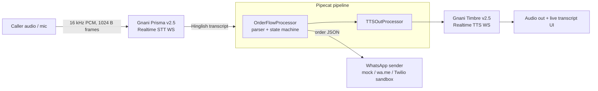

# KiranaVoice 🛒📞
A voice agent that picks up a kirana shop's phone when the owner's hands are full. It takes the order in Hinglish, reads it back, handles corrections, and sends the owner a clean order summary on WhatsApp. Built for the Gnani AI Great Indian AI Internship Challenge. **All data is synthetic.**

## Architecture

Flow: greeting → items/qty → read-back ("Sahi hai?") → corrections ("Nahi nahi, 12 ande" → "Done, 12 ande") → name → phone → closing → WhatsApp summary.
Handles unclear qty ("Sorry, atta kitne kilo?"), unknown items ("kaju abhi stock mein nahi hai"), removals ("maggi hata do"), Devanagari digits and words (२, दो, do, aadha, dedh, darjan), and "bhej do" (the verb, not the number 2).

Order JSON: `{customer_name, phone, items:[{name, qty, unit}], timestamp}` (IST).

## Models used
| Model | Use | Status |
|---|---|---|
| Gnani **Prisma v2.5** STT, Realtime WebSocket `wss://api.vachana.ai/stt/v3/stream` (`lang_code: hi-IN`, 16 kHz PCM) | caller speech → text | **verified live 2026-10-22**: message format `connected` → `speech_start` → `transcript {text, is_final, latency}`. Output is Devanagari, so the parser has Devanagari aliases. |
| Gnani **Timbre v2.5** TTS, Realtime WebSocket `wss://api.vachana.ai/api/v1/tts` (`model: timbre-v2.5`, `language: hi-en`, voice Nalini) | agent replies → speech | **verified live 2026-10-22**: format `start` → `audio {data:{chunk_index, audio:<b64 PCM>}}` |
| Evon | **not used** (open weights only, not offered on the API) | — |
| Order understanding | original rule-based Hinglish/Devanagari parser (no LLM) | tested |

Measured on 2026-10-22, synthetic audio, small samples (see `audio/*_results.json`):
- Timbre time to first audio: 1060–1223 ms (median ≈1.1 s, n=9), including a new WebSocket and TLS handshake per line.
- Prisma: WER 0.154 / 0.25 / 0.0 on 3 clips (n=20 reference words, pooled ≈0.15) against hand-written Devanagari references, with numerals mapped to words. End of audio to final transcript was 300–422 ms (includes the VAD silence wait). The server-reported `latency` was 87–193 ms.
- The customer clips are Timbre-generated (voice Deepak), **not real human speech**. Real phone audio will score differently.
- One live end-to-end run (`live_e2e.py`) of the full call worked: Prisma → Pipecat OrderFlow → Timbre → WhatsApp (wa.me), and the order JSON was correct.
- Not verified: browser-mic live mode in the UI, word boosting (`x-bias-list`), and 8 kHz telephony audio.

Docs: https://docs.gnani.ai/api/introduction/introduction · https://docs.gnani.ai/api/STT/stt-websocket · https://docs.gnani.ai/api/TTS/tts-websocket · Pipecat: https://github.com/pipecat-ai/pipecat

## Run
```bash
./setup.sh                      # creates the venv, installs, and runs: python run.py --mock
# open http://127.0.0.1:8000/   → Answer → "▶ Play demo script" (or type Hinglish lines)
# vertical 1080x1920 for video:  http://127.0.0.1:8000/?layout=vertical&autoplay=1
python run.py --mock --whatsapp wame       # click-to-send wa.me link
python run.py --live   # reads GNANI_API_KEY from .env.local     # real Prisma + Timbre, mic button (spends credits)
TWILIO_*=... OWNER_WHATSAPP_TO=... python run.py --mock --whatsapp twilio
python -m pytest -q
```
Mock mode spends zero credits: the "STT" is text in, and the "TTS" is a short chime, with the text shown in the UI.
URL flags: `layout=vertical`, `autoplay=1`, `gap=<ms between lines>`, `mute=1`.

## Credits budget
Don't test in `--live` mode with long calls. Use the demo script (5 short lines) for the final real-audio check.

## Layout
`kiranavoice/parser.py` (Hinglish NLU), `flow.py` (state machine), `pipeline.py` (Pipecat), `adapters/gnani.py`, `adapters/mock.py`, `whatsapp.py`, `server.py` (FastAPI + WS), `static/` (self-hosted UI, no CDNs), `tests/`.

## Contributions
Karthik: _TBD_ · Yash: _TBD_ (to fill in for the writeup)
