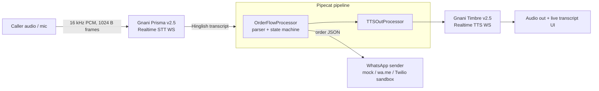

# KiranaVoice: a phone line that takes orders when the shopkeeper can't

**Gnani AI – Great Indian AI Internship Challenge | Written submission (DRAFT)**  
**Team:** U. Kaustubha Karthik (2nd-year B.Tech AI&ML, Anurag University, Hyderabad) and Yash

---

## Problem

A lot of neighbourhood kirana business still happens over a phone call. A regular customer rings and reads out a list. The trouble is that the owner is usually busy weighing dal or giving change, so the call goes unanswered or the order gets half-heard and scribbled down.

For a kirana shop, a missed call is basically a lost order. The customer just calls the next shop.

We didn't want to fix this with an app; asking people to install something new is where most "digital kirana" ideas fall apart. Our one rule: no app install, no behaviour change.

## What we built

KiranaVoice is a voice agent that answers the shop's phone when the owner can't pick up. It talks to the customer in Hinglish, takes the order, reads it back for confirmation, handles corrections, and sends a clean order summary to the owner's WhatsApp.

The customer just makes a normal phone call. The owner just checks WhatsApp when they have a free moment.

We showed the idea to a real kirana owner. They called it "decent" and said they would pay Rs 200–300 per month for it. That's one informal conversation, not a study, but it's a signal worth following.

## How it works



The pipeline runs on **Pipecat**. Prisma transcripts go into an `OrderFlowProcessor` (our own rule-based Hinglish parser, no LLM, plus a small state machine). A `TTSOutProcessor` speaks each reply through Timbre and shows it in the live transcript. When the call closes, the order goes to a WhatsApp sender.

The flow is: **greeting → items and quantities → read-back ("Sahi hai?") → corrections → name → phone → closing → WhatsApp summary.** Each order is stored as JSON, with an IST timestamp:

```json
{
  "customer_name": "...",
  "phone": "...",
  "items": [{ "name": "...", "qty": 0, "unit": "..." }],
  "timestamp": "..."
}
```

**How the edge cases are handled in the build (all covered by tests):**

- **Unclear quantity:** the agent asks instead of guessing ("Sorry, atta kitne kilo?"); lines it can't parse get "Sorry, samajh nahi aaya".
- **Corrections:** at the read-back, "Nahi nahi, 12 ande" replaces the old quantity and the agent confirms "Done, 12 ande". Removals like "maggi hata do" drop the item and re-read the order.
- **Unknown items:** anything outside the shop's (synthetic) catalogue is flagged, not dropped: "kaju abhi stock mein nahi hai. Aur kuch?"
- **Hinglish numbers:** २, दो, aadha, dedh, darjan; "bhej do" is read as the verb, not the number 2.

**Demo-script call (mock mode, typed text, synthetic data):**

> **Agent:** Namaste! Sharma Kirana se bol rahe hain. Bataiye, kya bhejna hai?
>
> **Customer:** Bhaiya, 2 kilo atta, 1 litre Fortune oil aur 6 ande bhej do
>
> **Agent:** Theek hai, 2 kilo atta, 1 litre Fortune oil, 6 ande. Sahi hai?
>
> **Customer:** Nahi nahi, 12 ande
>
> **Agent:** Done, 12 ande. Aur kuch?
>
> *(then name, phone, closing, and the WhatsApp summary)*

## Gnani models used and why

**Prisma v2.5 (speech-to-text), via Realtime WebSocket.** This is the core of the project. Our callers are on noisy phone lines, mixing Hindi and English. Gnani states Prisma is trained on 14M+ hours of Indian telephonic audio, handles code-mixed Hinglish, and streams at around 200ms, which is exactly our audio. Our adapter uses the docs' telephony VAD settings and can send a bias list of catalogue words (atta, kilo, litre…), though word boosting hasn't been verified yet. Prisma returns Devanagari text, so the parser also has Devanagari aliases.

**Our measurements (live API, 2026-10-22, small samples):** Prisma got 3 of 20 reference words wrong across 3 clips (pooled WER ≈ 0.15, i.e. about 15%), scored against hand-written Devanagari references. From end of audio to final transcript took 300–422 ms, which includes the VAD silence wait; the server-reported latency was 87–193 ms.

**Timbre v2.5 (text-to-speech, beta), via Realtime WebSocket** (`timbre-v2.5`, `hi-en`). The read-back only works if the customer can clearly hear what's being confirmed. Timbre supports 10+ Indic languages, Indian number cadence and SSML. We use the voice Nalini. **Measured:** time to first audio was 1060–1223 ms (median ≈ 1.1 s, n = 9), and that includes opening a new WebSocket and TLS handshake for each line.

We are not using Evon (it's open weights only, not offered on the API).

**Status, to be clear:** one full call ran end to end on the live API: Prisma → Pipecat OrderFlow → Timbre → WhatsApp (wa.me link), and the final order was correct (2 kg atta, 1 L Fortune oil, 12 ande). **Important caveat:** all the numbers above were measured on synthetic customer audio generated with Timbre (voice Deepak), **not real callers or real human speech**. Real phone audio (including 8 kHz telephony) will score differently and hasn't been tested yet.

## Demo

The demo simulates a call in a web UI: incoming-call screen, live transcript, an order card that updates as items change, and the owner's WhatsApp summary. "Play demo script" runs the five-line call above, and a vertical 1080×1920 layout (`?layout=vertical&autoplay=1`) is ready for the video. All data is synthetic.

In mock mode the "STT" is typed text, the "TTS" is a short chime, and the WhatsApp summary is logged and offered as a wa.me link. The test suite (parser, state machine, Pipecat session end-to-end, Twilio request shape) passes **16/16 in mock mode**.

The real Prisma + Timbre path has been run once end to end (see above). Live browser-mic mode is built and running in live mode on Karthik's PC, but it hasn't been tested with a real microphone yet. **Not run yet:** Twilio WhatsApp delivery and the one-command setup script.

**About the voices in the demo video:** the narrator and customer are our teammate Karthik's real recorded voice. The agent's voice is real Gnani Timbre audio (voice Nalini), so what you hear from the agent is the actual model output.

{width=6in}

{width=6in}

Demo video/post: [demo post TBD]

## What's next

- Test Prisma on real human callers and 8 kHz phone audio (so far it has only been measured on synthetic Timbre audio), and test the live browser-mic mode (already built and running on Karthik's PC) with a real microphone.
- Verify the one-command setup script on a clean machine.
- Connect a real phone number instead of the simulated call (not built yet).
- Live WhatsApp delivery: a Twilio sandbox sender is written and its request format unit-tested, but it hasn't sent a real message yet.
- Pilot with the owner we spoke to and a few more shops, to see if the Rs 200–300/month interest holds up.
- Support more regional languages beyond Hinglish, building on Timbre's Indic language coverage.

## Team & contributions

*(Each member was interviewed separately; final text to be filled in from those interviews.)*

**U. Kaustubha Karthik:** [Karthik: TBD]

**Yash:** [Yash: TBD]

**Shared work:** [TBD]

## Links

- Code repository: [repo TBD]
- Demo post: [demo post TBD]
